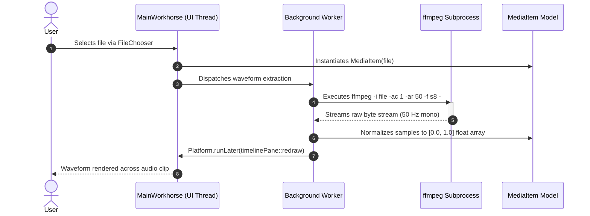
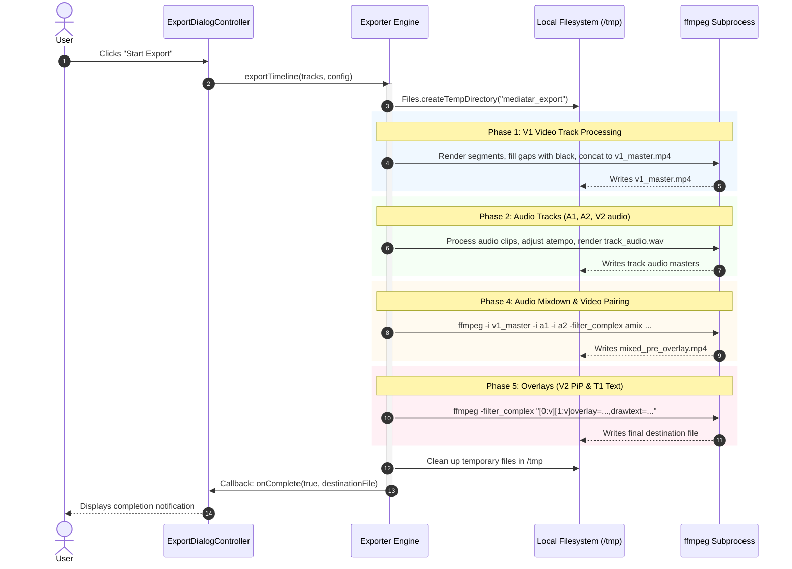

# Architecture: Communication and Subprocesses

MMediatar operates without HTTP networking or client-server sockets. All communication takes place via:
1. **Thread-to-UI Event Dispatching:** Background threads update JavaFX UI elements via `Platform.runLater()`.
2. **Subprocess Pipes:** Standard input/output/error pipes connecting the JVM to `ffmpeg` and `ffprobe` processes.

---

## Communication Table

| Boundary | From | To | Transport | Format | Purpose |
|---|---|---|---|---|---|
| **Audio Downmixing** | `MainWorkhorse` | `ffmpeg` | Subprocess Pipe (`ProcessBuilder`) | Raw 8-bit mono PCM (`-f s8`) | Generating normalized audio waveform peaks |
| **Media Transcoding** | `MainWorkhorse` | `ffmpeg` | Subprocess Execution | CLI args + File I/O | Transcoding unsupported video/audio on import |
| **Stream Probing** | `MainWorkhorse` | `ffprobe` | Subprocess Pipe | JSON / CLI text | Detecting media duration, streams, and codecs |
| **Export Execution** | `Exporter` | `ffmpeg` | Multi-step Subprocess | Filtergraph CLI args | Track gap-filling, concat, audio mixing, overlays |
| **Log Streaming** | `ffmpeg stderr` | `ExportDialogController` | Java Thread `BufferedReader` | Plain text lines | Real-time console progress in UI dialog |
| **Playback Sync** | `AnimationTimer` | `MediaPlayer` | JavaFX Event Loop | Method calls (`seek()`, `play()`) | Multi-track playhead synchronization |

---

## Media Import and Waveform Extraction Sequence

When a user imports an audio or video file, MMediatar computes normalized amplitude peaks for waveform visualization:

---

## Multi-Pass Export Execution Sequence

The export pipeline (`Exporter.java`) executes asynchronously to prevent UI freeze:

---

## Thread Safety and Stream Consumption

To prevent deadlocks when executing native subprocesses in Java:
- `ProcessBuilder` merges standard error with standard output (`redirectErrorStream(true)`) or consumes standard error concurrently using a dedicated `BufferedReader`.
- Stream consumption lines are parsed and forwarded to JavaFX UI controls strictly wrapped inside `Platform.runLater(() -> callback.onLog(line))`.
- Cancellation safely signals `process.destroyForcibly()` to terminate any orphaned transcoding subprocesses.

For data serialization and file formats, see [data-and-storage.md](data-and-storage.md).
