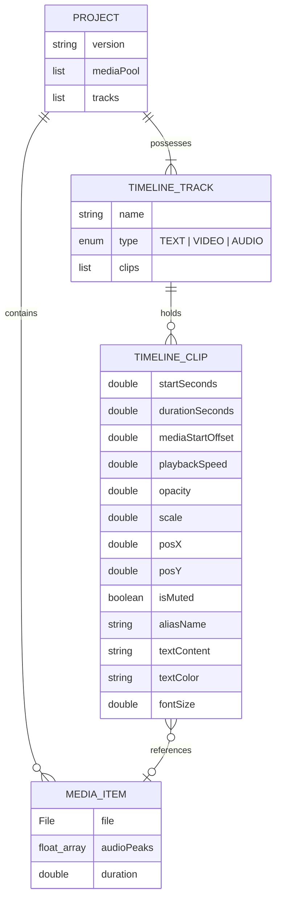

# Architecture: Data and Storage

This document details the in-memory data structures, project file persistence format (`.mediatar`), and temporary filesystem lifecycle utilized by **MMediatar**.

## In-Memory Entity Relationship Diagram

The in-memory data model mirrors non-linear editing concepts:



---

## The `.mediatar` Project File Format

Project files in MMediatar are single-file encrypted archives with the extension `.mediatar`. 

### Encryption Specification
- **Cipher:** AES (`AES/ECB/PKCS5Padding`)
- **Key Length:** 128-bit (16 bytes)
- **Key Material:** Static application key (`MediatarKeySec26`)
- **Payload:** UTF-8 encoded XML document

```
+-------------------------------------------------------+
|  AES-128 Ciphertext (.mediatar file)                  |
|  +-------------------------------------------------+  |
|  | Decrypted XML Document (version 1.0)             |  |
|  | <project version="1.0">                         |  |
|  |   <mediaPool> ... </mediaPool>                  |  |
|  |   <tracks> ... </tracks>                        |  |
|  | </project>                                      |  |
|  +-------------------------------------------------+  |
+-------------------------------------------------------+
```

### Decrypted XML Schema Structure

```xml
<?xml version="1.0" encoding="UTF-8" standalone="no"?>
<project version="1.0">
  <mediaPool>
    <file>/home/user/Videos/clip1.mp4</file>
    <file>/home/user/Music/song.mp3</file>
  </mediaPool>
  <tracks>
    <track name="T1" type="TEXT">
      <clip>
        <start>0.0</start>
        <duration>5.0</duration>
        <offset>0.0</offset>
        <speed>1.0</speed>
        <opacity>1.0</opacity>
        <isMuted>false</isMuted>
        <scale>1.0</scale>
        <posX>0.0</posX>
        <posY>0.0</posY>
        <textContent>Intro Title</textContent>
        <textColor>#ffffff</textColor>
        <fontSize>32.0</fontSize>
      </clip>
    </track>
    <track name="V1" type="VIDEO">
      <clip>
        <filePath>/home/user/Videos/clip1.mp4</filePath>
        <start>0.0</start>
        <duration>12.5</duration>
        <offset>2.0</offset>
        <speed>1.0</speed>
        <opacity>1.0</opacity>
        <aliasName>Opening Scene</aliasName>
        <isMuted>false</isMuted>
        <scale>1.0</scale>
        <posX>0.0</posX>
        <posY>0.0</posY>
      </clip>
    </track>
    <track name="V2" type="VIDEO">
      <!-- Picture-in-picture video track -->
    </track>
    <track name="A1" type="AUDIO">
      <!-- Primary audio track -->
    </track>
    <track name="A2" type="AUDIO">
      <!-- Secondary / background audio track -->
    </track>
  </tracks>
</project>
```

---

## File Resolution and Relinking

`ProjectSerializer` stores absolute paths to source media files in the XML document.
- **Relinking Strategy:** If a media file path does not exist on disk during project load, `ProjectSerializer` marks the item as missing but maintains the timeline clip structure (preserving offsets, cuts, and speed settings).
- For instructions on reconnecting moved files, refer to the [Backup and Restore Runbook](../runbooks/backup-and-restore.md).

---

## Temporary Storage Lifecycle (`/tmp`)

During timeline export, MMediatar utilizes the OS temporary directory:
1. **Creation:** `Files.createTempDirectory("mediatar_export")` creates `/tmp/mediatar_exportXXXXXXXXX/`.
2. **Intermediate Artifacts:**
   - `v1_master.mp4`: Gap-filled and concatenated V1 track.
   - `v2_audio.wav`: Audio stream extracted from PiP video.
   - `track_i.wav`: Audio track masters processed with `atempo`.
   - `mixed_pre_overlay.mp4`: Combined audio/video before text/PiP overlay.
3. **Destruction:** Upon success or exception handling, all files in the directory are deleted and the directory removed.
4. **Safety Mechanisms:** If the JVM process is terminated abruptly (SIGKILL or power loss), temporary files may remain. Refer to [Restart Runbook](../runbooks/restart.md) for automated cleanup procedures.

For packaging and runtime environment distribution, see [deployment.md](deployment.md).
