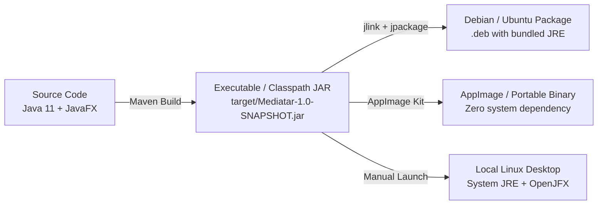

# Architecture: Deployment and Packaging

This document describes the compilation, distribution, and runtime packaging models for **MMediatar** across Linux environments.

## Deployment Models

Because MMediatar is a standalone JavaFX desktop application, it can be distributed in three primary forms:



---

## 1. Maven Development Execution (Current)

The primary deployment mechanism during active development relies on the `javafx-maven-plugin` (version 0.0.8):

```xml
<plugin>
    <groupId>org.openjfx</groupId>
    <artifactId>javafx-maven-plugin</artifactId>
    <version>0.0.8</version>
    <configuration>
        <mainClass>com.nicch.mediatar.App</mainClass>
        <options>
            <option>-DGST_PLUGIN_PATH=/usr/lib/x86_64-linux-gnu/gstreamer-1.0</option>
            <option>-Djava.library.path=/usr/lib/x86_64-linux-gnu/gstreamer-1.0</option>
        </options>
    </configuration>
</plugin>
```

---

## 2. Self-Contained Native Bundle (`jpackage`)

Using JDK 14+ `jpackage`, MMediatar can be compiled into a native Linux installer (`.deb` or `.rpm`) that bundles a trimmed JVM runtime generated via `jlink`.

### Modular JRE Assembly with `jlink`

Because `module-info.java` declares explicit module dependencies:
```java
module com.nicch.mediatar {
    requires javafx.controls;
    requires javafx.fxml;
    requires javafx.media;
    requires java.xml;
    opens com.nicch.mediatar to javafx.fxml;
    exports com.nicch.mediatar;
}
```

A minimal runtime can be created without shipping the entire 300MB JDK:

```bash
jlink --module-path $JAVA_HOME/jmods:/path/to/javafx-jmods-22.0.1 \
      --add-modules com.nicch.mediatar \
      --output target/mediatar-runtime \
      --strip-debug \
      --compress 2 \
      --no-header-files \
      --no-man-pages
```

### Packaging `.deb` with `jpackage`

```bash
jpackage --type deb \
         --dest target/dist \
         --name mediatar \
         --module com.nicch.mediatar/com.nicch.mediatar.App \
         --runtime-image target/mediatar-runtime \
         --icon src/main/resources/com/nicch/mediatar/logo.png \
         --app-version 1.0.0 \
         --linux-shortcut \
         --linux-menu-group "AudioVideo;Video;AudioVideoEditing;"
```

---

## 3. Headless CI / Container Execution

For automated testing or headless validation without an X11/Wayland display server, MMediatar executes using `Xvfb` (Virtual Framebuffer):

```bash
# Start virtual X11 server
Xvfb :99 -screen 0 1920x1080x24 &
export DISPLAY=:99

# Run JavaFX tests or verification
mvn clean test
```

## System Dependency Requirements by Distribution

| Dependency | Ubuntu / Debian Package | Fedora / RHEL Package | Arch Linux Package |
|---|---|---|---|
| OpenJDK 11 | `openjdk-11-jdk` | `java-11-openjdk-devel` | `jdk11-openjdk` |
| FFmpeg | `ffmpeg` | `ffmpeg` | `ffmpeg` |
| GStreamer Core | `libgstreamer1.0-0` | `gstreamer1` | `gstreamer` |
| GStreamer Plugins | `gstreamer1.0-plugins-base`, `gstreamer1.0-plugins-good` | `gstreamer1-plugins-base`, `gstreamer1-plugins-good` | `gst-plugins-base`, `gst-plugins-good` |

For security implications of native packaging and subprocess execution, see [threat-model.md](threat-model.md).
