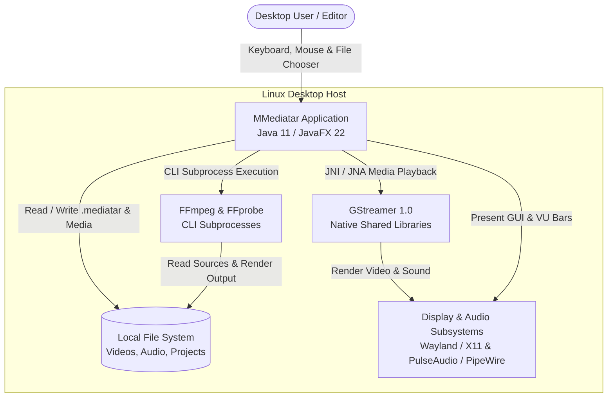
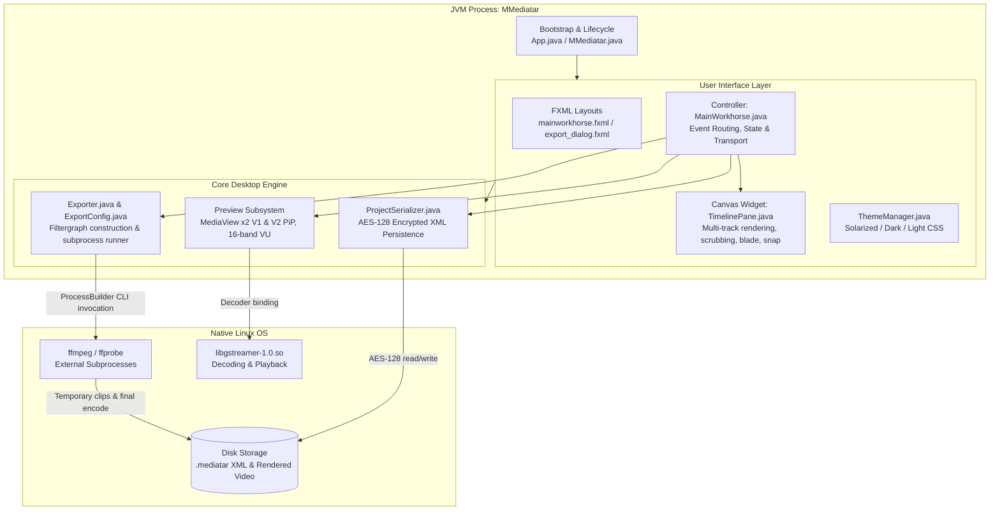

# Architecture Overview

MMediatar is an offline, standalone desktop multi-track video editor built on the Java Virtual Machine using JavaFX 22.0.1 and native FFmpeg subprocesses.

## System Context (C4 Context)

---

## Container & Component Architecture (C4 Container)

Within the JVM process, MMediatar is partitioned into decoupled subsystems:

---

## Subsystem Breakdown

| Subsystem | Primary Source Files | Runtime Role | Communication Mechanism |
|---|---|---|---|
| **Bootstrap & Lifecycle** | `App.java`, `MMediatar.java` | Initializes JavaFX runtime, loads icons, sets up responsive primary Stage | In-process JavaFX `Application.launch()` |
| **Main Workhorse Controller** | `MainWorkhorse.java` | Manages track data models, playhead animation timer, audio sync, transport controls, inspector panel | JavaFX property bindings & event handlers |
| **Timeline Canvas** | `TimelinePane.java` | Custom `Canvas` widget drawing 5 tracks (T1, V1, V2, A1, A2), clips, selection borders, playhead, snapping lines, waveforms | Direct double-buffered 2D canvas drawing |
| **Preview & VU Meter** | `MainWorkhorse.java`, `TimelinePane.java` | Two stacked `MediaView` elements (V1 primary, V2 picture-in-picture) and 16-band `AudioSpectrumListener` | JavaFX `MediaPlayer` callbacks |
| **Rendering Pipeline** | `Exporter.java`, `ExportConfig.java` | Translates timeline track state into complex FFmpeg command lines (gap filling, concat, amix, overlay, drawtext) | Standard I/O stream redirection via `ProcessBuilder` |
| **Project Persistence** | `ProjectSerializer.java` | Serializes tracks, clips, speeds, and overlays into AES-128 encrypted XML files (`.mediatar`) | In-memory DOM parser (`javax.xml`) and `Cipher` |
| **Theming** | `ThemeManager.java` | Controls unified color palette across workspace and dialogs | Dynamic JavaFX inline CSS injection |

---

## Process Model and Trust Boundaries

- **Single User Desktop Application:** MMediatar runs entirely within the user's desktop session. There are no remote daemon processes, server ports, or multi-tenant boundaries.
- **Process Isolation:** Heavy media rendering and transcoding are isolated to external `ffmpeg` subprocesses. If FFmpeg crashes due to a corrupt codec stream, the JVM UI remains responsive and captures the standard error log.
- **File System Permissions:** The application operates strictly with the privileges of the running Linux user account, accessing media files and project storage locally.

For deep dive into subprocess interaction, see [communication.md](communication.md).  
For the persistence schema and encryption details, see [data-and-storage.md](data-and-storage.md).
