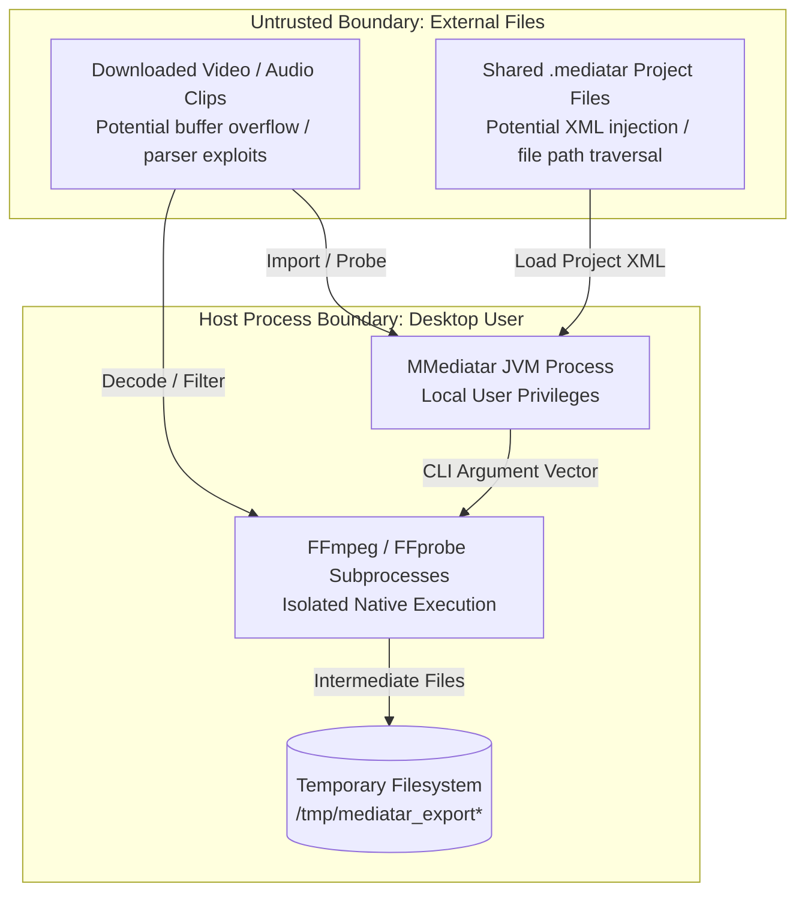

# Architecture: Threat Model

This document outlines the threat modeling, STRIDE assessment, and security posture of **MMediatar** as a Linux desktop application interacting with untrusted media files, external subprocesses, and the local file system.

## Trust Boundaries and Attack Surfaces



---

## STRIDE Threat Assessment

| Threat Category | Potential Attack Vector | Impact | Mitigations in Codebase |
|---|---|---|---|
| **Spoofing** | Untrusted project file pretending to be authored by another user. | Low (desktop app). | Projects store local paths; no user credentials or digital signatures are claimed. |
| **Tampering** | Modification of `.mediatar` ciphertext to alter clip properties or inject malicious file paths. | Medium: Application could load unintended local files. | `ProjectSerializer` uses AES-128 encryption. Corrupted XML throws `SAXParseException` on parse. |
| **Repudiation** | Denying an export operation occurred. | Non-applicable: Local single-user desktop software. | N/A |
| **Information Disclosure** | Intermediate video frames and audio clips stored in world-readable `/tmp`. | Medium: Sensitive video frames accessible to other users on shared Linux machines. | `Files.createTempDirectory()` creates directory with default POSIX permissions (`0700` restricted to owning user). |
| **Denial of Service** | Malformed media files causing FFmpeg or JavaFX Media decoder to hang, consume 100% CPU, or exhaust `/tmp`. | High: Desktop freeze, disk space exhaustion. | Subprocesses run asynchronously with manual cancellation hooks (`destroyForcibly()`); disk errors caught gracefully. |
| **Elevation of Privilege** | Command injection via crafted file names or text overlays containing shell metacharacters. | Critical: Arbitrary code execution under user account. | **Mitigated:** All external processes are invoked via `java.lang.ProcessBuilder` using explicit `List<String>` argument vectors, bypassing the system shell (`/bin/sh`). |

---

## Command Injection Defense in Detail

A classic vulnerability in media tools is executing commands via shell string concatenation (e.g. `Runtime.getRuntime().exec("ffmpeg -i " + filename)`).

In MMediatar, **no shell is invoked**. `Exporter.java` builds an argument array:

```java
List<String> mixCmd = new ArrayList<>();
mixCmd.add("ffmpeg");
mixCmd.add("-hide_banner");
mixCmd.add("-y");
mixCmd.add("-i");
mixCmd.add(v1Master.getAbsolutePath()); // Passed as a single argv element
...
ProcessBuilder pb = new ProcessBuilder(mixCmd);
Process p = pb.start();
```

Because arguments are passed directly to the `execve` syscall:
- Spaces, semicolons, backticks, and pipes (`|`, `&`, `$()`) in file paths cannot trigger command injection.
- Quotation marks in text overlays (`T1` track) do not escape into the shell.

---

## Static AES Key Implications

`ProjectSerializer.java` uses a hardcoded 128-bit key (`MediatarKeySec26`) with `AES/ECB/PKCS5Padding`:
- **Purpose:** Obfuscates project structure and prevents casual tampering of `.mediatar` files.
- **Limitation:** Because the key is embedded in compiled bytecode, it does not protect confidential video projects against determined attackers with access to the project file.
- **Future Hardening:** Future releases will support user-provided passphrases with PBKDF2/AES-GCM encryption for zero-knowledge project secrecy.

For security coding standards and sanitization practices, see [Engineering Security](../engineering/security.md).
