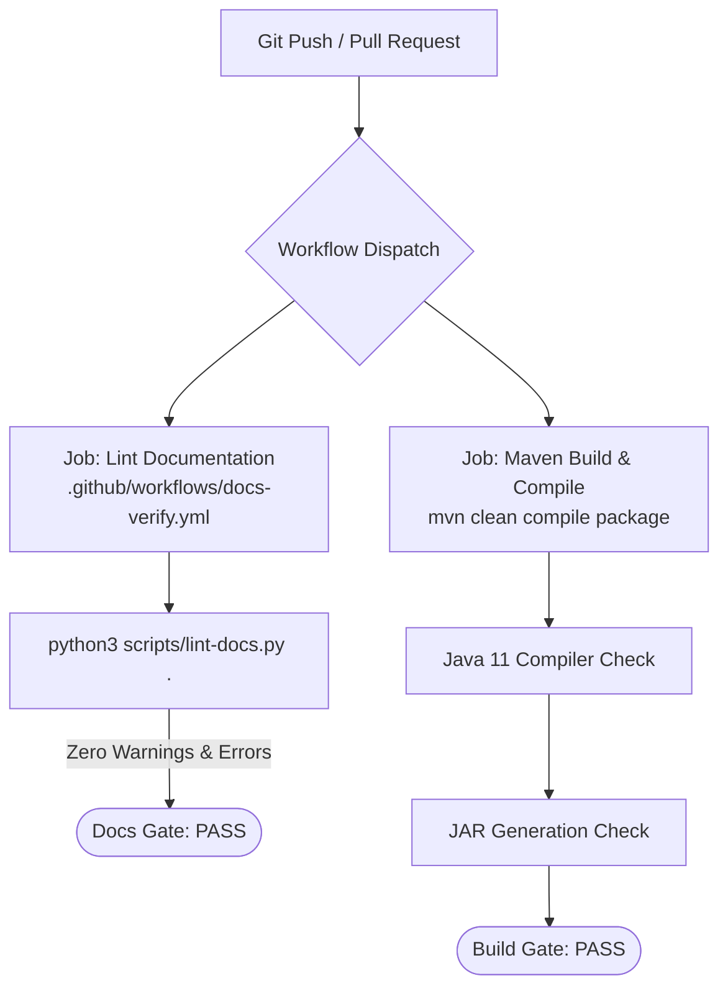

# Engineering: Continuous Integration (CI)

This document describes the automated continuous integration pipelines, quality gates, and automated linters configured for **MMediatar**.

## Workflow Architecture

MMediatar utilizes GitHub Actions to enforce code compilation and documentation quality on every commit and pull request.



---

## 1. Documentation Linter Workflow (`docs-verify.yml`)

Located at `.github/workflows/docs-verify.yml`, this job verifies all documentation against the project-docs v3.1 specification:

```yaml
name: Documentation Quality Verification

on:
  push:
    branches: [ master, main ]
    paths:
      - 'README.md'
      - 'docs/**'
      - 'mkdocs.yml'
      - 'scripts/lint-docs.py'
      - '.github/workflows/docs-verify.yml'
  pull_request:
    branches: [ master, main ]
    paths:
      - 'README.md'
      - 'docs/**'
      - 'mkdocs.yml'
      - 'scripts/lint-docs.py'
      - '.github/workflows/docs-verify.yml'

jobs:
  lint-docs:
    name: Lint Project Documentation
    runs-on: ubuntu-latest

    steps:
      - name: Check out repository
        uses: actions/checkout@v4

      - name: Set up Python
        uses: actions/setup-python@v5
        with:
          python-version: '3.11'

      - name: Run project-docs Quality Linter
        run: |
          python3 scripts/lint-docs.py .
```

---

## 2. Recommended Build & Verification Workflow

To validate compilation on clean runner environments, add `.github/workflows/build.yml`:

```yaml
name: Build and Verify

on:
  push:
    branches: [ master, main ]
  pull_request:
    branches: [ master, main ]

jobs:
  build:
    name: Maven Build on Ubuntu
    runs-on: ubuntu-latest

    steps:
      - name: Check out code
        uses: actions/checkout@v4

      - name: Set up JDK 11
        uses: actions/setup-java@v4
        with:
          java-version: '11'
          distribution: 'temurin'
          cache: maven

      - name: Install System Dependencies
        run: |
          sudo apt-get update
          sudo apt-get install -y ffmpeg libgstreamer1.0-0 gstreamer1.0-plugins-base xvfb

      - name: Build with Maven
        run: mvn -B clean package
```

For developer contribution guidelines, see [contributing.md](contributing.md).
