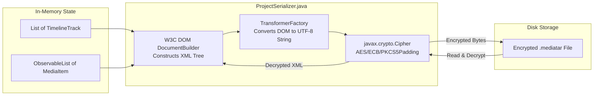

# Engineering: Persistence and Serialization

This document details the persistence architecture, DOM XML serialization, and AES encryption mechanisms implemented in `ProjectSerializer.java` for storing `.mediatar` project files.

## Storage Engine Architecture

Because MMediatar is a single-user desktop application, it does not employ a relational SQL database. Instead, the entire project workspace state is serialized into an XML document and encrypted on disk using AES.



---

## The XML Document Model

The XML tree conforms to standard W3C DOM specifications:

```xml
<project version="1.0">
  <mediaPool>
    <file>/absolute/path/to/media.mp4</file>
  </mediaPool>
  <tracks>
    <track name="V1" type="VIDEO">
      <clip>
        <filePath>/absolute/path/to/media.mp4</filePath>
        <start>0.0</start>
        <duration>5.0</duration>
        <offset>0.0</offset>
        <speed>1.0</speed>
        <opacity>1.0</opacity>
        <isMuted>false</isMuted>
        <scale>1.0</scale>
        <posX>0.0</posX>
        <posY>0.0</posY>
      </clip>
    </track>
  </tracks>
</project>
```

---

## Encryption Implementation

Encryption and decryption are handled by private methods in `ProjectSerializer`:

```java
private static final byte[] KEY_BYTES = "MediatarKeySec26".getBytes(StandardCharsets.UTF_8);

private static byte[] encrypt(byte[] plaintext) throws Exception {
    SecretKeySpec secretKey = new SecretKeySpec(KEY_BYTES, "AES");
    Cipher cipher = Cipher.getInstance("AES/ECB/PKCS5Padding");
    cipher.init(Cipher.ENCRYPT_MODE, secretKey);
    return cipher.doFinal(plaintext);
}

private static byte[] decrypt(byte[] ciphertext) throws Exception {
    SecretKeySpec secretKey = new SecretKeySpec(KEY_BYTES, "AES");
    Cipher cipher = Cipher.getInstance("AES/ECB/PKCS5Padding");
    cipher.init(Cipher.DECRYPT_MODE, secretKey);
    return cipher.doFinal(ciphertext);
}
```

---

## Schema Evolution and Backwards Compatibility

When extending the XML schema with new attributes or child tags:

1. **Defensive Parsing:**
   Always use helper methods that check for null or empty elements before parsing numbers:
   ```java
   private static String getChildText(Element parent, String tagName) {
       NodeList list = parent.getElementsByTagName(tagName);
       if (list.getLength() > 0 && list.item(0).getFirstChild() != null) {
           return list.item(0).getTextContent();
       }
       return null;
   }
   ```
2. **Safe Defaults:**
   If a tag is absent (e.g. loading a project saved before the `isMuted` or `rotation` property was introduced), provide a fallback:
   ```java
   String mutedVal = getChildText(clipNode, "isMuted");
   boolean isMuted = (mutedVal != null) && Boolean.parseBoolean(mutedVal);
   ```
3. **Version Bumping:**
   If a breaking structural change is introduced, increment the root attribute `<project version="2.0">` and add a migration handler in `loadProject()`.

For testing and verification procedures, see [testing.md](testing.md).
