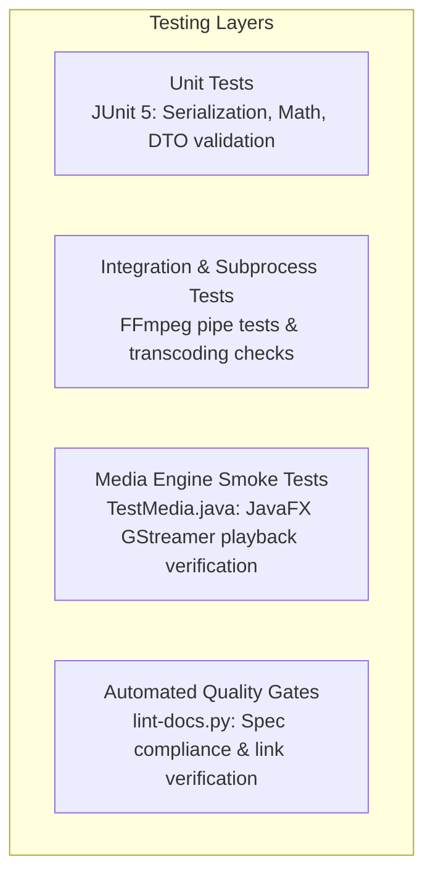

# Engineering: Testing

This document details the testing architecture, manual verification procedures, and automated test strategies for **MMediatar**.

## Testing Architecture

Testing a desktop video editor requires testing three distinct layers:



---

## 1. Unit Testing Strategy

Unit tests target isolated algorithmic components without requiring a graphics display server:

- **Project Persistence:** Test saving a dummy project, encrypting it, and decrypting it to verify identical track and clip attributes.
- **Timeline Math:** Verify pixel-to-second and second-to-pixel coordinate conversions, zoom scaling, and snapping threshold calculations.
- **Export Filtergraph Generation:** Assert that `Exporter` constructs syntactically valid FFmpeg filter strings (e.g. `amix`, `overlay`, `drawtext`).

Example JUnit 5 serialization test:

```java
@Test
void testProjectSerializerRoundTrip() throws Exception {
    File tempFile = File.createTempFile("test_project", ".mediatar");
    tempFile.deleteOnExit();

    List<MainWorkhorse.TimelineTrack> tracks = new ArrayList<>();
    MainWorkhorse.TimelineTrack track = new MainWorkhorse.TimelineTrack("V1", MainWorkhorse.TrackType.VIDEO);
    tracks.add(track);

    ProjectSerializer.saveProject(tempFile, Collections.emptyList(), tracks);
    ProjectSerializer.LoadedProject loaded = ProjectSerializer.loadProject(tempFile);

    assertEquals(1, loaded.tracks.size());
    assertEquals("V1", loaded.tracks.get(0).getName());
}
```

---

## 2. Media Playback Smoke Test (`TestMedia.java`)

The repository includes a standalone test file `TestMedia.java` to verify that JavaFX Media can successfully link to native GStreamer libraries:

```bash
# Compile and run TestMedia
javac --module-path /usr/share/openjfx/lib \
      --add-modules javafx.media \
      TestMedia.java

java --module-path /usr/share/openjfx/lib \
     --add-modules javafx.media \
     -DGST_PLUGIN_PATH=/usr/lib/x86_64-linux-gnu/gstreamer-1.0 \
     -Djava.library.path=/usr/lib/x86_64-linux-gnu/gstreamer-1.0 \
     TestMedia
```

If GStreamer is correctly linked, the program prints `Success` and exits.

---

## 3. Headless UI Testing with Xvfb

To execute JavaFX tests in CI or headless environments without an active monitor:

```bash
# Start Xvfb virtual framebuffer
Xvfb :99 -screen 0 1920x1080x24 &
export DISPLAY=:99

# Run Maven test lifecycle
mvn test
```

---

## 4. Documentation Quality Testing

Run the local project-docs linter before submitting code:

```bash
python3 scripts/lint-docs.py .
```

The script verifies:
- `README.md` length $\le 150$ lines.
- Zero leaked code-editing instructions in user README.
- Zero broken internal Markdown relative links.
- Syntactic correctness of all Mermaid diagram blocks.
- Zero detected API keys, passwords, or credentials.

For CI configuration, see [ci.md](ci.md).
